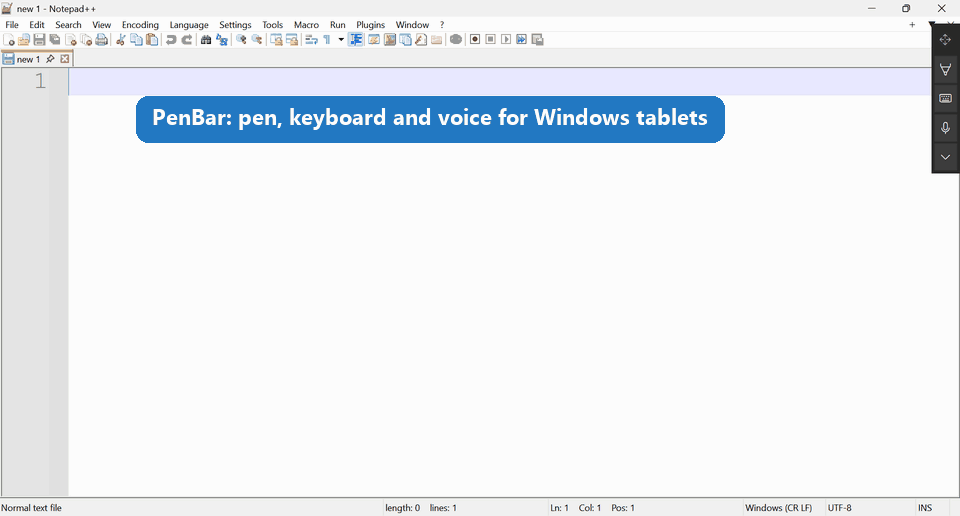
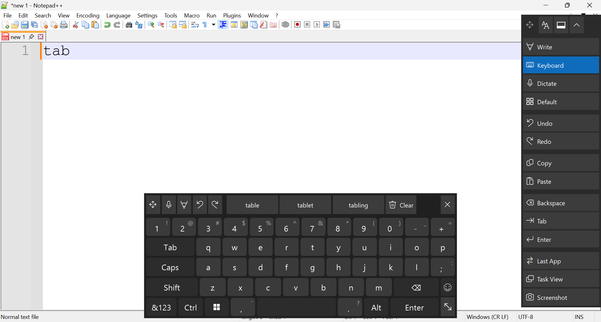
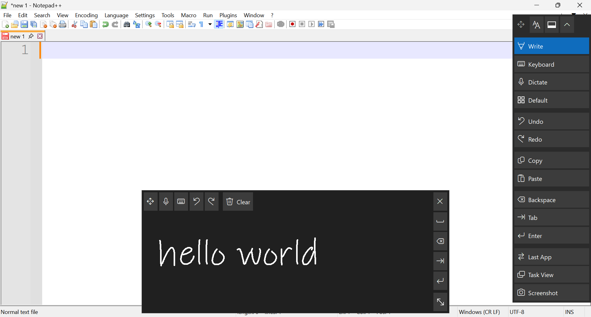
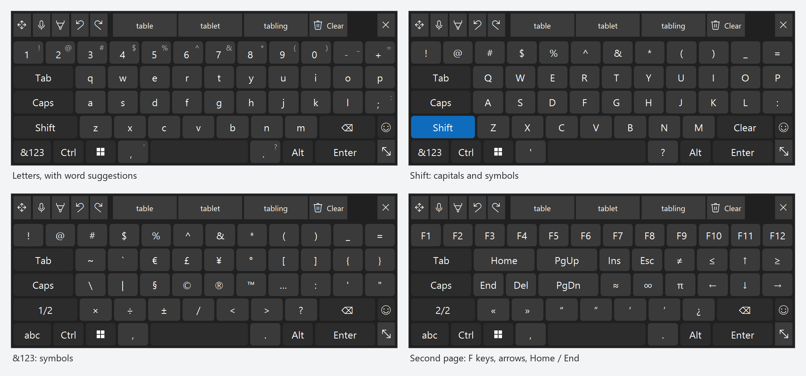
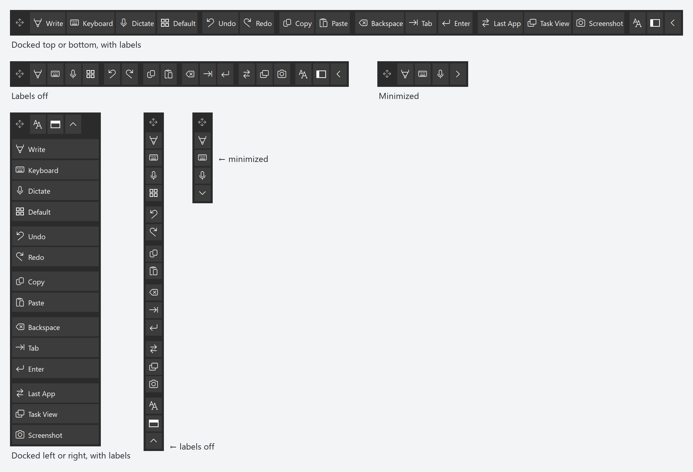

# PenBar

**The missing toolbar for Windows tablets and 2-in-1s.** Handwriting, a swipe
keyboard, voice dictation and one-tap shortcuts, all in a bar that docks to
any screen edge and never steals focus from your app.

Free and open source. Works offline, with no account and no telemetry.

**[⬇ Download PenBar.exe](https://github.com/z1ad/PenBar/releases/latest)** ·
`winget install z1ad.PenBar` · [Website](https://z1ad.github.io/PenBar/) ·
[What's new in 1.1](CHANGELOG.md)



## Why PenBar?

PenBar turns your tablet or 2-in-1 into a complete keyboard-free setup:

- **Pen, keyboard and voice, one tap apart.** Write, Keyboard and Dictate sit
  side by side, and one tap on the pad flips between handwriting and typing.
- **Undo that respects your writing.** Handwriting is undone **one word at a
  time**, so a slip never costs you a whole sentence.
- **Every shortcut at your fingertips.** Copy, Paste, Undo, Tab, Enter,
  Alt+Tab and Screenshot are a single tap.
- **A keyboard built for real work.** A full number row, Ctrl/Alt/Win keys,
  F keys, arrows, swipe typing and word suggestions.

## Features

### ✍️ Handwriting pad
- Write with the pen, pause, and the text is typed into whatever app you're
  using.
- Up to three suggestions appear at the top. Tap one to fix a misread word.
- **Undo and Redo work word by word** for anything you wrote on the pad.
- Your palm can rest on the screen. Touches outside the writing area are
  ignored, and you can write with a pen or a finger.
- Space, Backspace, Tab and Enter buttons sit beside the writing area.
- Uses the handwriting recognizer built into Windows, so it works offline.

### ⌨️ Keyboard
- **Swipe typing**: slide across the letters and lift, with no start-up
  delay.
- **Word suggestions** as you type. Tap one to finish the word.
- **Hold a key** for accents and extra symbols (é, ñ, ü, €, …).
- A number row on the main page, a **symbols page** laid out like a real
  keyboard, and a second page with **F1–F12, arrows, Home/End, PgUp/PgDn,
  Esc and Del**.
- **Ctrl, Alt and Win** keys stay on for the next key, so shortcuts like
  Ctrl+S or Alt+F4 work.
- An emoji button opens the Windows emoji panel.

### 🎤 Dictation
- **Dictate** starts Windows voice typing in the app you're using.
- Prefer no overlay? Switch to the offline, inline mode in the tray menu.

### 🧰 Shortcut toolbar
- **Write · Keyboard · Dictate · Default** (the Windows touch keyboard)
- **Undo · Redo · Copy · Paste**
- **Backspace · Tab · Enter**
- **Last App** (Alt+Tab) · **Task View** · **Screenshot**

### 📐 Fits your screen
- **Dock** to the left, right, top or bottom edge, or let it float. Drag it
  away from an edge to float it, or back to an edge to dock it again.
- **Horizontal or vertical**, **labels on or off**, and **minimize** to a
  compact Write / Keyboard / Dictate strip. The arrow points the way it opens.
- **Resize** the pad by dragging its corner, or tap the corner to shrink it to
  the smallest size.
- **Dark theme** throughout. The pad and keyboard never take focus, so your
  cursor stays where it was.
- **Auto-minimizes** when you attach a keyboard and expands again in tablet
  mode. It can start with Windows.

## Screenshots

| Keyboard, with the bar docked on the right | Handwriting pad |
|---|---|
|  |  |

**Keyboard pages:** letters, Shift, symbols, and F keys with arrows.



**Bar layouts:** horizontal or vertical, with or without labels, and minimized.



## Install

### The ready-to-run app (easiest)

No other software needed.

- **winget** (built into Windows 11). Open Terminal and run:

  ```powershell
  winget install z1ad.PenBar
  ```

  Then start it by typing `PenBar` in Terminal or the Run box (Win+R).

- **Or download** `PenBar.exe` from the
  [latest release](https://github.com/z1ad/PenBar/releases/latest), put it in
  a permanent folder, and double-click it.

The app isn't code-signed yet, so Windows may show **"Windows protected your
PC"** the first time. Choose **More info → Run anyway**. Settings are saved in
`%APPDATA%\PenBar\PenBar.ini`.

### Run the script with AutoHotkey

Use this if you want to read or change the code.

1. Install AutoHotkey v2:

   ```powershell
   winget install --id AutoHotkey.AutoHotkey --exact
   ```

2. Download this repository (**Code → Download ZIP**) or clone it, and put the
   folder somewhere permanent, such as `Documents\PenBar`:

   ```powershell
   git clone https://github.com/z1ad/PenBar.git
   ```

3. Double-click `PenBar.ahk`. Settings are saved in `PenBar.ini` next to it.

PenBar adds itself to Windows startup the first time it runs. To stop that,
untick **Start with Windows** in the tray menu. To quit, right-click the tray
icon and choose **Exit**.

## Tips

- **Swap input fast:** the pen / keyboard button at the top of the pad
  switches between handwriting and the keyboard, keeping the pad where it is.
- **Tab for autocomplete:** in VS Code, terminals, Copilot or the browser
  address bar, tap **Tab** to accept a suggestion without a keyboard.
- **Accents:** hold a letter on the keyboard, slide to the one you want, and
  lift.
- **Shortcuts:** tap Ctrl (it turns blue), then tap a key. For example, Ctrl
  then S saves.

**Tray menu** (right-click the tray icon): open the handwriting pad, choose a
dock edge, add a space after each word, choose what Undo does outside the pad,
minimize when a keyboard is attached, choose a dictation mode, start with
Windows, set how long a pause types your handwriting (0.6–2 s), and reset
positions.

## Optional Windows settings

PenBar doesn't change any Windows settings. If Windows' own pen and keyboard
pop-ups get in the way, you can switch these off yourself:

| What it stops | Where |
|---|---|
| Touch keyboard popping up when you tap a text field | Settings → Time & language → Typing → Touch keyboard → **Show the touch keyboard** → **Never**. PenBar's buttons still work. |
| Windows' handwriting box appearing when you write in a text field | Settings → Bluetooth & devices → Pen & Windows Ink → turn off **Shell handwriting** |
| Pen menu opening when you take the pen out | Settings → Bluetooth & devices → Pen & Windows Ink → turn off the option that opens the pen menu when the pen is removed |
| Taskbar hiding app icons in tablet mode | Settings → Personalization → Taskbar → Taskbar behaviors → untick **Optimize taskbar for touch interactions when this device is used as a tablet** |

Setting names can differ slightly between Windows 11 versions.

## Uninstall

1. In the tray menu, untick **Start with Windows**, then choose **Exit**.
2. Remove PenBar: `winget uninstall z1ad.PenBar`, or delete the PenBar folder.
3. Optionally delete the settings folder `%APPDATA%\PenBar`.

## Building the app

```powershell
& "$env:LOCALAPPDATA\Programs\AutoHotkey\Compiler\Ahk2Exe.exe" /in PenBar.ahk /out dist\PenBar.exe /base "$env:LOCALAPPDATA\Programs\AutoHotkey\v2\AutoHotkey64.exe"
```

The version, icon and file details come from the `;@Ahk2Exe-` lines at the
top of `PenBar.ahk`. `words.txt` (the word list for suggestions and swipe) and
`dictate.ps1` (offline dictation) are bundled into the exe.

## Contributing

Bug reports, ideas and pull requests are welcome. Please
[open an issue](https://github.com/z1ad/PenBar/issues). PenBar was built on a
Samsung Galaxy Book3 360; reports from other pen devices are especially
helpful.

If PenBar makes your tablet nicer to use, a ⭐ helps other people find it.

## License

PenBar is free and open source under the [MIT License](LICENSE).
